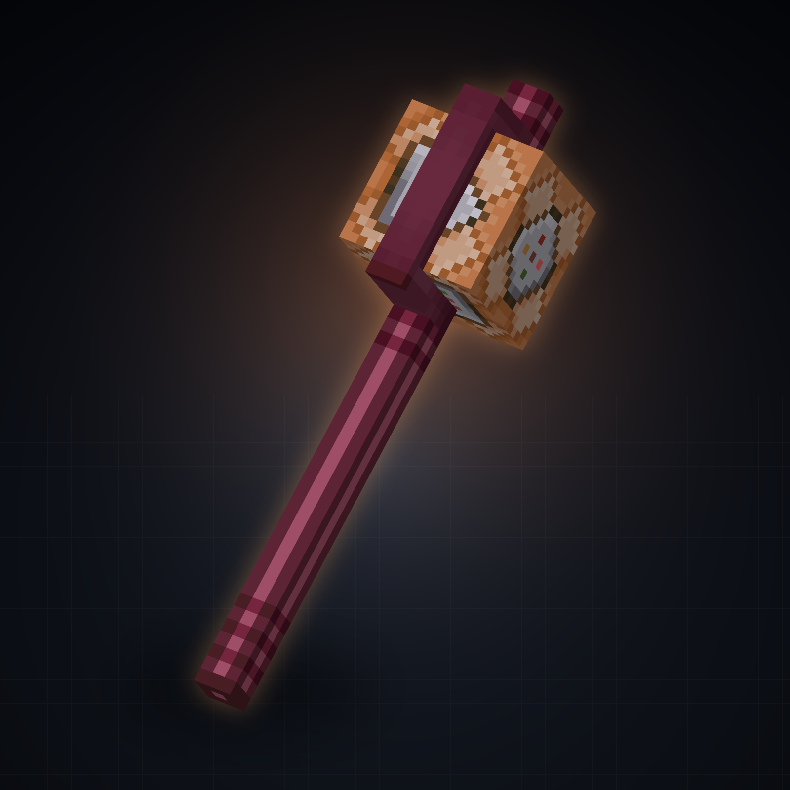

# 命令方块权杖

Minecraft **26.2** 的 Fabric 客户端模组：手持权杖，用轮盘选技能，右键释放命令。



## 功能

- **按住 R**：打开扇形技能轮盘（12 个槽位）
- **按 N**：打开技能配置
- **按 B**：打开全局设置
- **右键**：释放当前技能
- **Alt + 滚轮**：调整当前技能的 `@f` 距离
- 所有页面都只有在**手持权杖**时才能打开

权杖默认是木棍，可在 B 页输入任意物品 ID（例如 `minecraft:stone`）。修改后物品模型会立即切换，不需要重载资源。

## 技能

每个技能槽可以单独配置：

- 名称、类型
- 单条指令 / 循环指令 / 连锁指令
- 连锁的每条指令及距上一条的延迟（tick）
- `@f` 距离
- `@f` 坐标是否取整
- `@t` 指向玩家时传 UUID 还是玩家名

技能类型：

- **脉冲**：按一次执行一条指令
- **连锁**：按顺序执行多条指令
- **循环**：按住右键期间按频率重复执行

## 选择器

| 写法 | 含义 |
| --- | --- |
| `@t` | 准星上的实体。被方块挡住时不会选中墙后的实体 |
| `@f` | 沿视线走当前技能距离、被方块截断的坐标；可跟原版相对坐标后缀，例如 `@f~ ~-1 ~` |
| `@t @f` | `@t` 选实体，`@f` 取该实体之外的独立落点，因此 `tp @t @f` 不会把目标传送到它自己脚下 |

`@f` 的方块坐标模式在 B 页切换：

- `方块自身`
- `相邻方块`（类似原版放置方块的位置）

B 页还有 **`@f 空气坐标`**：

- `选取`：允许 `@f` 落在空气中的距离终点
- `不选取`：`@f` 必须落在方块上；落空时该条指令不发送

## 指令编辑

N 页和连锁编辑页里的指令框都是只读显示框，点击后进入独立的「指令编辑」页：

- 单行长输入框
- 原版指令补全
- 保存 / 取消
- `@t`、`@f` 只在编辑页内部作为合法语法解析，保存后仍是原文本

## 环境

- Minecraft 26.2
- Fabric Loader 0.19.5+
- Fabric API 0.161.0+26.2
- Java 25

## 安装

1. 安装 Fabric Loader 与 Fabric API
2. 将 `command_wand-*.jar` 放入 `.minecraft/mods/`
3. 启动游戏，手持权杖物品（默认木棍）

这是纯客户端模组，服务器无需安装。

## 构建

```bash
./gradlew build
```

产物在 `build/libs/`。

## 许可

见 [LICENSE](LICENSE)。
